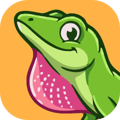
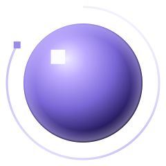
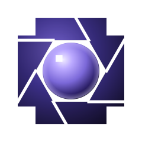
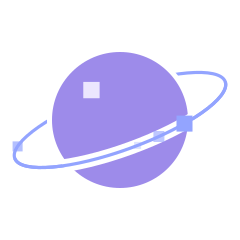

 

## ⚙️ Engines

-  **[Anole](https://github.com/xuckless/anole)** — Zig backend framework: REST, WebSockets, WebTransport and gRPC over HTTP/1.1, /2 and /3, with TLS and auth built in · `Zig` `QUIC` `io_uring` · [docs](https://xuckless.github.io/anole/)
-  **[PIXL Engine](https://engine.pixlfoundation.com)** — Rust image engine that never guesses: every call returns a receipt of what it did · `Rust` `WGSL` `RAW · JPEG XL · AVIF`

## 🤖 AI agents

Experienced in **agentic workflows**, **agent development** and **prompt engineering**.
To show it, I built my own coding harness from scratch, **[EveryAI](https://github.com/xuckless/everyai-mono)**,
made to compete with opencode and the other open-source harnesses.

   

## 🚀 Projects

**Apps**
-  **[Pixl Playroom](https://github.com/xuckless/pixl-playroom)** — Lightroom-style photo editor with pro color grading, no subscription · `PIXL` `public beta` · [site](https://playroom.pixlfoundation.com)
-  **[Space Pixl](https://github.com/xuckless/space-pixl)** — reclaim storage by re-encoding your photo library with PIXL · `PIXL` · [site](https://space.pixlfoundation.com)
-  **[EveryAI](https://github.com/xuckless/everyai-mono)** — Claude Code / Codex-style coding agent for every OpenRouter model, BYOK · `Flutter` `Anole`
-  **[Skink](https://github.com/xuckless/skink)** — modeless terminal code editor: Micro's keys, LSP, git, a real terminal and AI agents (ACP) · `Rust` · [site](https://skink.cc)
-  **[Wubble](https://github.com/xuckless/wubble)** — Chromium-based browser with vertical tabs, Spaces and split view, GPU-composited glass UI · `Rust` `Slint` · [site](https://wubble.cc)
-  **[Everymail](https://github.com/xuckless/everymail)** — mail client for every inbox, with agents you control · `Rust` `early`
-  **[Grain](https://github.com/xuckless/grain)** — stem separation, karaoke with live pitch, a Melodyne-style pitch editor and local AI production · `Rust` `Svelte`
-  **[Manga Translator](https://github.com/xuckless/manga-translator)** — self-hosted: finds balloons, translates in context with Claude, re-letters English to fit · `Python`
-  **[quikResume](https://github.com/xuckless/quikresume)** — one library, a tailored résumé per job, with an AI assistant · `Next.js` `Typst WASM` · [site](https://quikresume.vercel.app)
-  **[Money Insighter](https://github.com/xuckless/money-insighter)** — local-first personal finance: every account in one ledger, with graphs · `Electron` `Go` `Postgres`
-  **[Tranzit](https://github.com/xuckless/tranzit)** — Calgary transit, routed and tracked in real time · `Expo` `Go` `OpenTripPlanner`

**Games**
-  **[gorescii](https://github.com/xuckless/gorescii)** — old-school FPS drawn in ASCII in your terminal, no dependencies · `C++20`
-  **[Tic Tac Toe Ultimate](https://github.com/xuckless/TicTacToeUltimate)** — pieces vanish, every game ends in a win; real-time ranked PvP · `.NET` `SignalR` `Go bots` · [play](https://tictactoeultimate.alidirect.dev)
-  **[The Desired Path](https://github.com/xuckless/the-desired-path)** — a court of petitions and consequences, as a visual novel · `Java`

**Linux hardware tools** — browser GUI + CLI, unofficial
- 🖱️ **[mousectl](https://github.com/xuckless/mousectl)** — Instant A704 mouse: remapping, macros, DPI, RGB
- ⌨️ **[deerctl](https://github.com/xuckless/deerctl)** — Drunkdeer magnetic keyboards (G65, A75…), Linux and macOS
- 🌀 **[msictl](https://github.com/xuckless/msictl)** — MSI Mystic Light RGB, fan curves, sensors and CPU power limits

**Robotics & coursework**
- 🚗 **[ros2-vslam](https://github.com/xuckless/ros2-vslam)** — lane-aware traffic-sign navigation for the AgileX LIMO with a self-trained YOLOv8 · `ROS 2` `Python`
-  **[Demo Airline](https://github.com/xuckless/demo-airline)** · **[Gridworld Solver](https://github.com/xuckless/gridworld-solver)** · **[Futoshiki Solver](https://github.com/xuckless/futoshiki-puzzle-solver)** · **[Nachos OS](https://github.com/xuckless/COSC-3407-projects)**

## 🤝 Open source

     

## 🧰 Toolbox

